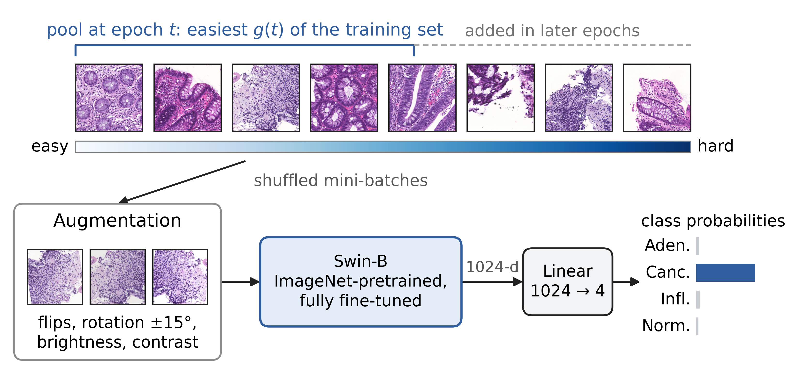

# Effect of Sample Difficulty Ordering on Curriculum Learning for Vision Transformer-Based Colorectal Tissue Classification

Curriculum learning presents training samples in order of difficulty, but its benefit depends on how difficulty is defined, and this choice is rarely examined directly. We compared six hardness scores and a random-order baseline for the classification of colorectal histopathology patches with a Swin Transformer. The scores were cross-entropy loss, boundary proximity and centroid distance, each computed with a fine-tuned ResNet50 and  with a frozen pathology foundation model (CONCH). Every strategy was trained in the easy-to-hard and hard-to-easy directions under three (linear, square root and step) pacing schedule for every strategy. Using a four-class colorectal tissue dataset (CRC) of 13,874 patches, the full design was repeated at 10%, 25%, 50%, and 100% of the training data. The best macro F1 was 90.90% for boundary proximity easy-to-hard against 90.67% for the random baseline.  On the public MHIST dataset, the ordering had a clearer effect: boundary proximity easy-to-hard reached 94.19% AUC and 86.49% macro F1, against 93.29% and 85.24% for the random baseline, and easy-to-hard ordering was better than hard-to-easy ordering for five of the six scores. A confirmatory experiment with 20 seeds showed that this gain was significant (p < 0.001).  Square-root and step pacing gave results close to linear pacing. On CRC, the adenomatous class was the hardest for the classifier (84.29 F1), and all scorers rated it above the average hardness.
 

 
